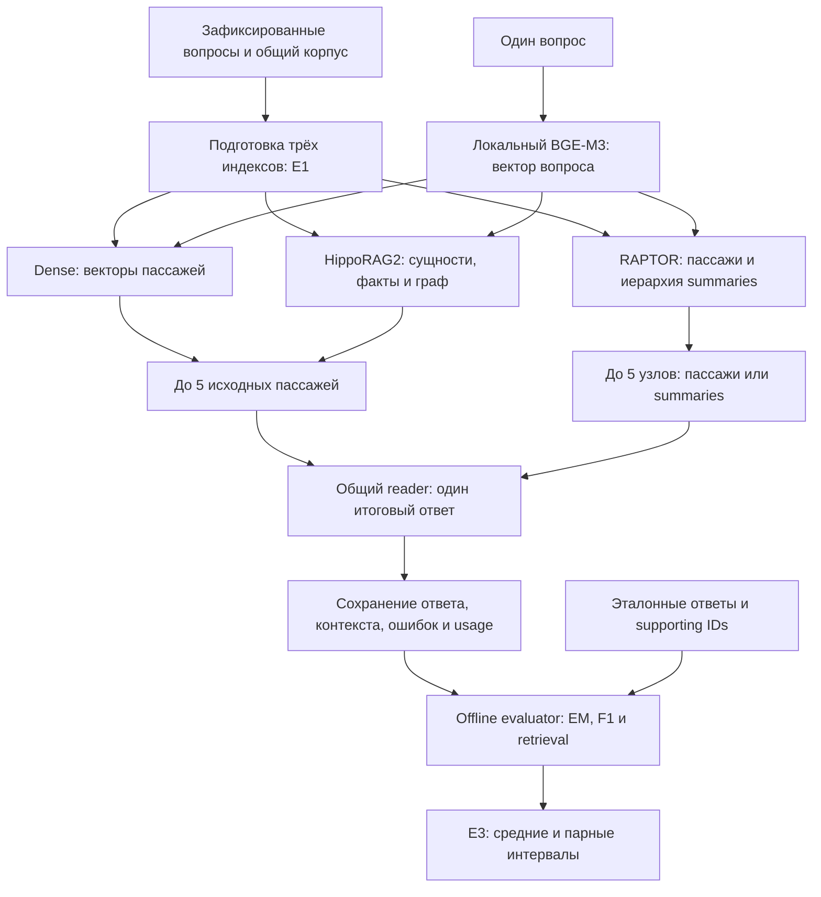

# Весь эксперимент: от корпуса до итоговой таблицы

Это описание **фактически выполненного сравнения** Dense RAG, HippoRAG2 и RAPTOR
на MuSiQue и HotpotQA. Цель — измерить, как способ поиска контекста меняет
качество ответа, время и расход при одном reader. Это не описание агентского
цикла и не план нового запуска.

**Масштаб:** 2 датасета × 3 метода × 500 вопросов = **3 000 случаев**.
Получено 2 996 ответов и 4 сбоя; незапущенных случаев в итоговой E3 нет.

## 1. Общая схема

На схеме показаны альтернативные ветки: **для одного случая выбирается один
метод**, а не запускаются все три поиска внутри одного ответа. Один question ID
проходит три отдельных случая. Полный готовый случай может быть переиспользован
из пилота; тогда новых embedding/filter/reader запросов для него нет.

## 2. Какие данные получает система

Источник — опубликованные данные репозитория HippoRAG 2, зафиксированные
ревизией и SHA в [sources.lock.json](../data/sources.lock.json). Это подготовленные
multi-hop QA данные, а не поиск по всему интернету или всей Википедии.

| Датасет | Вопросов | Общий корпус | Supporting-пассажей в корпусе | Дистракторов |
|---|---:|---:|---:|---:|
| MuSiQue | 500 | 5 500 | 882 | 4 618 |
| HotpotQA | 500 | 5 500 | 996 | 4 504 |

Подвыборки выбраны с seed 42 из упорядоченных ID. Все размеченные supporting
пассажи выбранных вопросов включены в корпус; остальная часть — дистракторы.
**Все три метода получают один и тот же корпус каждого датасета.** Поэтому
эксперимент проверяет поиск и ответ в ограниченном подготовленном корпусе,
а не способность сначала отыскать нужные статьи в открытом мире.

Файлы разделены по назначению:

| Файл | Кто его использует | Содержимое |
|---|---|---|
| `queries.json` | Поиск и reader | ID и текст вопроса |
| `corpus.json` | Индексация и поиск | ID, заголовок, текст пассажей |
| `labels.json` | Только offline evaluator | Ответы, допустимые алиасы, supporting IDs |
| `data/ids/*_s500.json` | План и проверки | Зафиксированный порядок 500 ID |

Корпус содержит готовые пассажи. В этом сравнении единица индексации — запись
`title + text`, а не заново подобранный размер чанка. Для HotpotQA supporting
сопоставляются по заголовку и полному тексту, с проверкой исходных индексов
предложений; для метрики используются supporting **passage IDs**.
Эталон ответа и supporting labels не передаются в генерацию и fact filter.

## 3. Что строится заранее — E1

Построены **шесть индексов**: по три на каждый датасет. В основном QA эти
индексы загружаются, а не пересоздаются на каждом вопросе.

| Метод | Подготовка индекса | Сохранённые объекты |
|---|---|---|
| Dense | BGE-M3 кодирует каждый исходный пассаж | Матрица векторов и соответствие passage ID |
| HippoRAG2 | LLM извлекает сущности и тройки фактов; BGE кодирует пассажи, сущности и факты; SDK собирает граф | Граф, факты, векторы и связь с исходными пассажами |
| RAPTOR | Исходные пассажи группируются по близости; LLM пишет summaries групп; summaries кодируются и объединяются в иерархию | Листья, summary-узлы, векторы и связи с исходными passage ID |

Dense-векторы исходных пассажей переиспользуются как листья RAPTOR после
проверки ID и модели. Это не три независимые оплаты одинаковых leaf embeddings.
RAPTOR использует `num_layers=2`, предел группы 3 000 токенов,
UMAP-размерность 5 и threshold 0,1; cap генерации summary — 4 096 токенов.
Эти настройки не подбирались по F1 в данном S500.

Основная LLM индексации — `iairlab/qwen3.8-27b`. У Hippo фактическое извлечение
**смешанное**: для ограниченной части length-сбоев использован разрешённый
fallback `iairlab/gpt-oss-120b`. Поэтому это не «чистый Qwen extractor».
В исходных фактах обнаружены и сохранены ошибки; семантическая корректность
всего графа не доказана. Готовность E1 означает проверку структуры, покрытия,
сохранения/загрузки и происхождения артефактов, а не отсутствие смысловых ошибок.

## 4. Что происходит с одним новым вопросом — E2

### Шаг 1. Проверка и embedding

Runner проверяет ID, хэши данных/индекса/плана, параметры и остаток бюджета.
Затем локальный `bge-m3:latest` создаёт 1 024-мерный вектор **текста вопроса**.
Digest BGE закреплён; это не разрешение на автоматическое обновление модели.
Каждый новый случай метода имеет свой учтённый query embedding. При reuse
готового случая этот шаг повторно не оплачивается.

### Шаг 2. Различающийся поиск

| Метод | Путь поиска для вопроса | Что передаётся reader | Дополнительная LLM перед reader |
|---|---|---|---|
| Dense | Косинусная близость вопроса к векторам пассажей; top-5 | До пяти исходных пассажей, в порядке поиска | Нет |
| HippoRAG2 | Поиск близких фактов → LLM fact filter → привязка к сущностям → Personalized PageRank по графу → ранжирование пассажей | До пяти исходных пассажей | Fact filter отбирает релевантные тройки |
| RAPTOR | Collapsed-tree поиск по векторам узлов всех уровней | До пяти узлов: исходные тексты и/или summaries | Нет: summaries уже построены в E1 |

У Hippo используются `linking_top_k=5` и damping 0,5. Если корректный ответ
fact filter не оставляет фактов, предусмотрен dense fallback; его признак
сохраняется. **Неверная структура ответа filter — ошибка, а не основание тихо
перейти к dense.** Новое извлечение фактов из корпуса на этом этапе запрещено.

Пять узлов RAPTOR не равны пяти исходным пассажам: один summary может охватывать
много документов. Это важное различие метода, хотя число контекстных элементов
на входе reader одинаково ограничено.

### Шаг 3. Один общий reader

| Параметр | Фактическая настройка |
|---|---|
| Модель | `iairlab/qwen3.8-27b`, API |
| Шаблон | `shared-answer-only-v1`, общий для обоих датасетов и трёх методов |
| Контекст | Заголовки и полные тексты выбранных элементов, в сохранённом порядке |
| Демонстрация | Один фиксированный пример вопроса/ответа, одинаковый для всех случаев |
| Выход | Одна строка `Answer: <краткий ответ>` |
| Генерация | temperature 0, seed 42, thinking выключен, output cap 512 |
| Ограничение входа | Не более 65 536 UTF-8 байт сериализованных messages; без скрытого обрезания |

Сообщения имеют вид: system-инструкция → фиксированный user-пример →
фиксированный assistant-ответ → найденные контексты и текущий вопрос.
System-инструкция просит вернуть ответ без рассуждений. Это **один reader-вызов**,
а не пять ответов и не серия уточняющих запросов по промежуточным ответам.
Параметр cap 512 — верхний предел выхода, а не требуемая длина ответа.
Байтовый порог — локальный guard; он не является измеренным размером окна backend.
Точная ревизия весов и квантование API backend не сообщены; известен alias модели.

### Шаг 4. Сохранение

До перехода к следующему случаю сохраняются выбранные контексты и их порядок,
исходный и разобранный ответ, операции embedding/filter/reader, длительности,
usage, ошибки и контрольные суммы. Завершённые оплаченные случаи не запускаются
повторно. Индексы при QA не перестраиваются.

## 5. Как именно считается качество

Один случай — **датасет × метод × question ID**. У каждого случая один итоговый
ответ. Поэтому **F1 не имеет суффикса @1 или @5**: это token F1 ответа.

| Метрика | Что сравнивается | Как читать |
|---|---|---|
| EM | Нормализованный итоговый ответ и допустимые эталоны | Доля точных совпадений |
| Answer F1 | Токены ответа и эталона; precision/recall их пересечения | Частичный балл даже при неточном ответе |
| Passage recall@5 | Первые пять найденных passage IDs и supporting passage IDs | Какая доля нужных исходных пассажей найдена; только Dense/Hippo |
| RAPTOR provenance coverage | Объединение исходных passage IDs выбранных узлов и supporting IDs | Покрытие источников summary-узлами; не passage recall@5 |

EM и F1 усредняются по **всем 500 случаям метода**, включая раскрытые failures
с pipeline EM/F1 = 0. Это оценка всего пайплайна. Сбой транспорта при этом не
называется неправильным ответом reader. Незавершённые/незапущенные вопросы
не подменяются нулевыми ответами: неполный запуск не выдаётся за полное сравнение.
Для answer scoring используются общий нормализатор и допустимые алиасы из labels.

## 6. Как получается итоговая E3

После завершения QA модели больше не вызываются. Offline evaluator заново
сверяет сохранённые ответы и все метрики, затем соединяет системы по одним
500 ID каждого датасета. Пропуски и дубликаты блокируют полную E3.

Для каждого датасета выполняются 1 000 bootstrap-повторов с seed 42. В повторе
с возвращением выбираются 500 индексов вопросов; **одни и те же индексы для
всех трёх систем**. Считаются средние EM/F1 и разности Hippo−Dense/RAPTOR−Dense.
95 % интервалы — процентили 2,5 и 97,5 %. Датасеты между собой не спариваются.
Пересечение интервала с нулём не доказывает эквивалентность систем.

## 7. Как из пилота получился полный S500

Это не один непрерывный запуск «с нуля». Финальный протокол использует
готовые индексы и по 200 исходов пилота каждого метода/датасета. Добавлены
только оставшиеся 300 случаев на конфигурацию: 1 800 новых случаев суммарно.
Ранняя reader-версия и диагностические запросы не смешиваются с финальными
ответами; в итог переиспользованы совместимые исходы зафиксированной версии.

| Датасет | Пилотных исходов, reuse | Новых случаев | Итоговых ответов | Сбоев | Не запущены |
|---|---:|---:|---:|---:|---:|
| MuSiQue | 600 | 900 | 1 499 | 1 | 0 |
| HotpotQA | 600 | 900 | 1 497 | 3 | 0 |

После остановок по ошибкам продолжались только ещё не запущенные случаи,
по отдельным разрешениям и с проверкой остатка общего бюджета. Оплаченные,
failed и unknown запросы не повторялись; старые планы и результаты неизменны.
Сохранены: два исторических transport failures (по одному на датасет),
известный reader failure и известная ошибка fact filter на HotpotQA.
Известные length/empty/parser ошибки reader — failure конкретного случая
без retry; filter, transport, unknown usage, pin и budget errors останавливают
очередь. Продолжение не стирало исходную ошибку и не ослабляло filter policy.

## 8. Что считается расходом и временем

| Область | Что входит | Что не следует прибавлять повторно |
|---|---|---|
| E1 | Построение индексов: extraction, summaries, embeddings | Повторно использованные leaf embeddings и готовые артефакты |
| Новые S500-запросы | Query embedding, Hippo fact filter, reader; включая ошибки | 600 пилотных исходов датасета |
| Совокупный E2 | Пилоты, разработка и новые физические запросы по lineage | Logical usage переиспользованных результатов |
| E3 | Только offline-расчёты по готовым ответам | Новых LLM/embedding запросов нет |

LLM input/output tokens и локальные BGE tokens хранятся раздельно. Неизвестный
usage — неизвестный, а резерв на него не является фактическим расходом.
Совокупный E2: 9 856 273 известных токена, 7 059 POST, две операции с неизвестным
usage и резерв 38 277. E1 отдельно: 32 601 955 известных токенов и резерв 61 588.
Историческая стоимость неполна; это не точная денежная стоимость эксперимента.

Среднее время в S500-таблицах относится к 300 новым случаям каждого метода:
query embedding + retrieval/filter + reader. Исключены загрузка индекса и паузы
между запросами. Время replay пилота не выдаётся за новый end-to-end прогон 500 вопросов.

## 9. Что позволяет и чего не позволяет утверждать результат

Измерен компромисс качества и затрат трёх retrieval-подходов при одном reader.
На MuSiQue и HotpotQA Hippo дал более высокое F1; на HotpotQA выигрыш +5,67 п.п.
с интервалом [3,37; 8,28] при большей задержке и расходе LLM-токенов.
Ожидание разрыва менее 2 п.п. не подтвердилось. Для RAPTOR убедительного
выигрыша над Dense по парным интервалам не видно.

**Ограничения:** S500 включает развитие протокола и пилот; это не независимый
тест. Для будущего сигнала заранее зафиксированы tuning300/check100/reserve100,
но полная S500-таблица не становится от этого нетронутым holdout. Примеры E3
брались только из tuning300. Здесь не выбирались сигнал, порог маршрутизации
или лучшая модель. Корректность всех extraction-фактов и всех исходных labels
не доказана; ограничения API revision и historical usage сохранены.

Будущий router/signal-check и LightRAG не входят в этот выполненный эксперимент.
Новых прогонов, моделей или перестроения индексов это описание не разрешает.

## Где проверить реализацию и результаты

| Что нужно проверить | Источник |
|---|---|
| Данные и выборка | [DATA](DATA.md), [ID и split](../data/ids/) |
| Индексация | [e1_indexers.py](../scripts/e1_indexers.py), [итог E1](../results/summary/e1-indexing.md) |
| Query retrieval | `retrieve_ready_e1`, `retrieve_hippo_query_only` в [e1_indexers.py](../scripts/e1_indexers.py) |
| Reader и evaluator | `question_result`, `answer_only_payload`, `score_result` в [e2_evaluation.py](../scripts/e2_evaluation.py) |
| Запуск, reuse и caps | [full_experiment.py](../scripts/full_experiment.py), [e2_s500.py](../scripts/e2_s500.py), [e2_hotpot.py](../scripts/e2_hotpot.py) |
| Парные интервалы | [E3_EVALUATION](https://github.com/SPStan/rag-graphrag-research/blob/codex/e3-paired-evaluation/docs/E3_EVALUATION.md), [код E3](https://github.com/SPStan/rag-graphrag-research/blob/codex/e3-paired-evaluation/scripts/e3_evaluation.py) |
| MuSiQue: качество и расход | [Таблица](../results/summary/e2-musique-s500.md) |
| HotpotQA: качество и расход | [Таблица](../results/summary/e2-hotpotqa-s500.md), [интерпретация](E2_HOTPOTQA_S500.md) |
| Общее сравнение с интервалами | [E3](https://github.com/SPStan/rag-graphrag-research/blob/codex/e3-paired-evaluation/results/summary/e3.md) |

Полные per-case ответы и контексты хранятся локально в `results/raw/`;
публичные отчёты содержат агрегаты, ID и контрольные суммы. Исходные runtime SHA
и execution plans не переписываются при редактуре этого документа.
